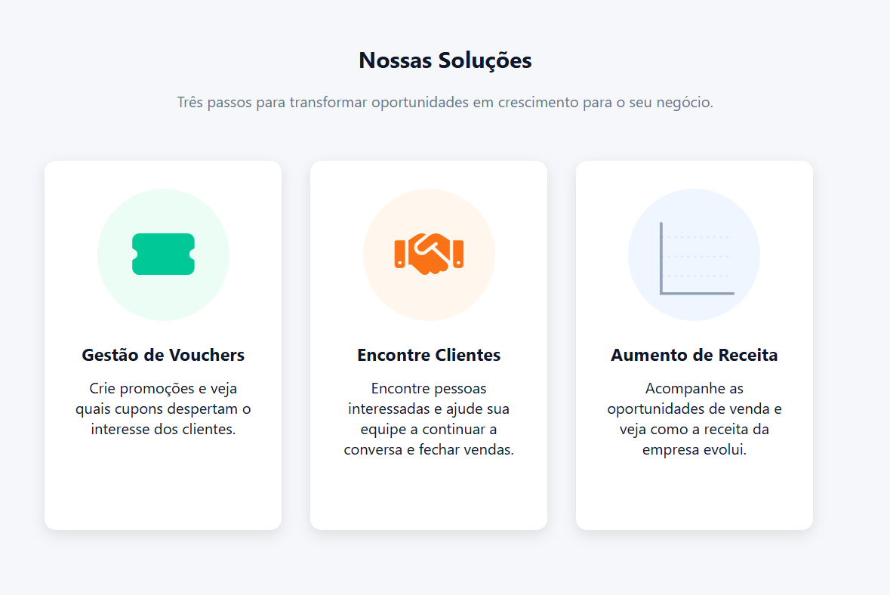
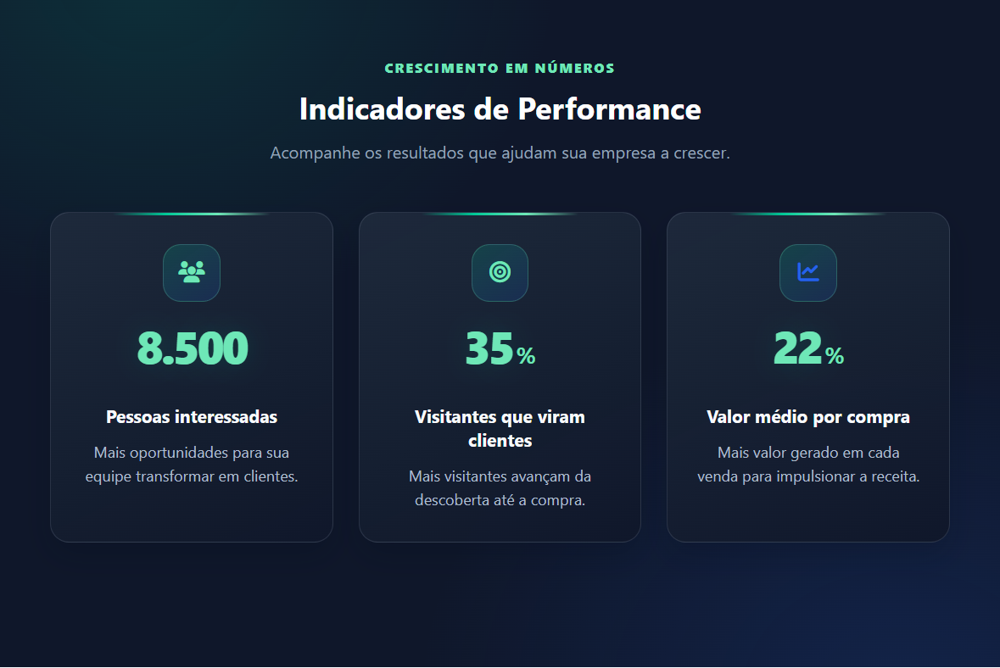
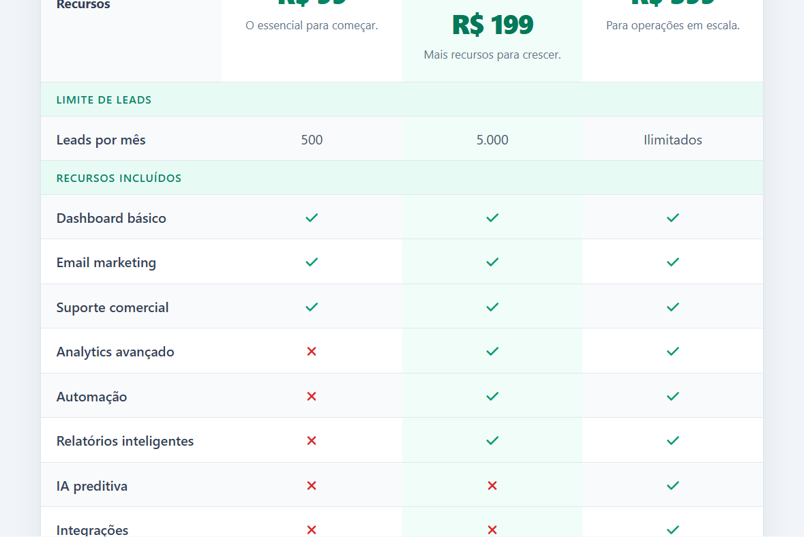
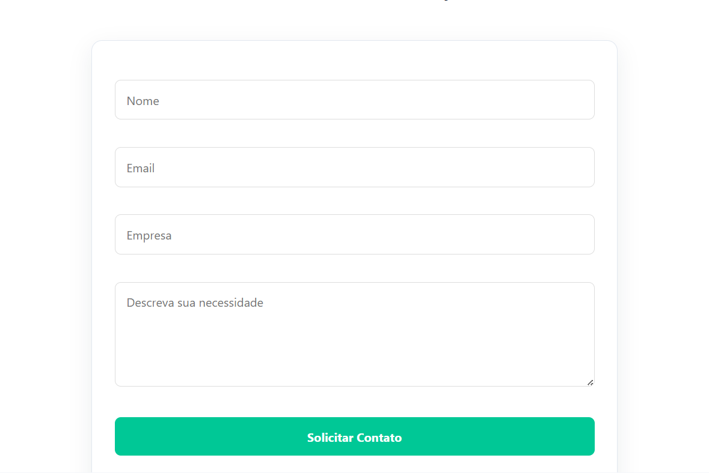

# DataGrowth Platform

Landing page desenvolvida para apresentar uma plataforma de geração de leads, automação de marketing e acompanhamento de performance de negócios.

## Sobre o projeto

Este projeto foi criado como parte de um estudo e prática em desenvolvimento front-end, com foco em HTML, CSS e JavaScript. A página apresenta uma estrutura moderna de marketing digital com:

- banner principal com destaque para conversão;
- seção de soluções e benefícios;
- indicadores de performance (KPIs);
- planos e preços;
- formulário de contato para captar leads;
- layout responsivo para diferentes tamanhos de tela.

## Demonstração visual

Veja algumas das principais áreas da landing page:

| Página inicial | Soluções |
|:--:|:--:|
|  |  |

| Indicadores de performance | Planos |
|:--:|:--:|
|  |  |

**Solicitação de demonstração**



## Tecnologias utilizadas

- HTML5
- CSS3
- JavaScript
- Font Awesome

## Estrutura do projeto

```bash
.
├── css/
│   └── style.css
├── Js/
│   └── script.js
├── img/
│   ├── readme-inicio.png
│   ├── readme-solucoes.png
│   ├── readme-resultados.png
│   ├── readme-planos.png
│   └── readme-contato.png
├── index.html
└── README.md
```

## Funcionalidades

- Navegação com links internos para as seções da página;
- Animação dos indicadores de desempenho;
- Design responsivo para desktop, tablet e mobile;
- Formulário de demonstração com interação em JavaScript;
- Interface visual com foco em conversão e profissionalismo.

## Como executar

1. Faça o download ou clone este repositório;
2. Abra o arquivo `index.html` em seu navegador;
3. Ou utilize um servidor local simples para visualizar a página.

## Objetivo

O projeto simula uma landing page para uma empresa B2B que oferece soluções para gestão de leads, aumento de receita e inteligência analítica.

## Contato

Se quiser entrar em contato, pode me enviar um e-mail:

- viniciosriboldimartins@gmail.com

Obrigado por visitar o meu repositório!
